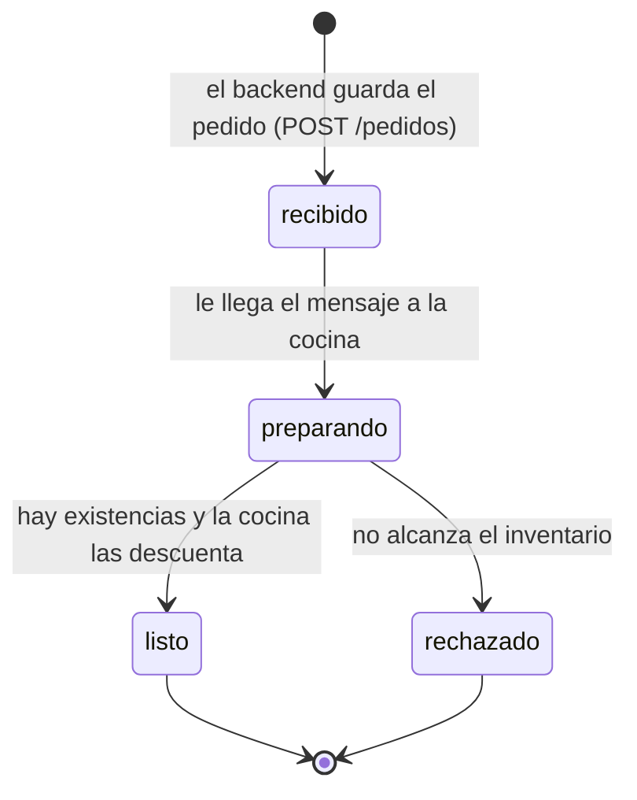

# Ciclo de vida de un pedido

Cada pedido es un documento en la colección `pedidos` de Firestore. Su campo `estado` pasa por estos valores:

| Transición | Quién la hace | Qué más cambia |
|---|---|---|
| (nuevo) → `recibido` | backend, en `POST /pedidos` | Se asigna `numero` y se publica el id en el tema |
| `recibido` → `preparando` | cocina, apenas recibe la entrega push | `actualizado` |
| `preparando` → `listo` | cocina, después de `TIEMPO_PREPARACION` segundos | Se descuenta cada producto en la colección `inventario` |
| `preparando` → `rechazado` | cocina, si algún producto no alcanza | Se escribe `motivo` y el inventario no cambia |

El frontend no cambia ningún estado. Solo consulta `GET /pedidos/<id>` y `GET /pedidos` cada pocos segundos.

## Qué ves cuando algo no está conectado

- **El pedido se queda en `recibido`.** El mensaje no le llega a la cocina: `TEMA` está vacía, no hay suscripción, o Pub/Sub no logra invocar a la cocina. Mira los logs del backend y de la cocina, y las métricas de la suscripción.
- **El pedido se queda en `preparando`.** La cocina recibió el mensaje pero falló antes de terminar. Es lo que pasa siempre con el plato misterioso: Pub/Sub lo reintenta y en los logs de la cocina aparece el error en cada intento. Sin un tema de mensajes muertos, esos reintentos siguen mientras Pub/Sub retenga el mensaje, que por defecto son 7 días, y llenan los logs de la cocina hasta que tu grupo resuelva esa parte del reto.
- **El inventario baja más de la cuenta.** El mismo mensaje llegó a la cocina más de una vez. Pub/Sub entrega cada mensaje *al menos* una vez, y con `PROBABILIDAD_FALLO` mayor que cero puedes provocarlo a propósito. El pedido vuelve a pasar por `preparando` y en los logs de la cocina aparece procesado varias veces.
